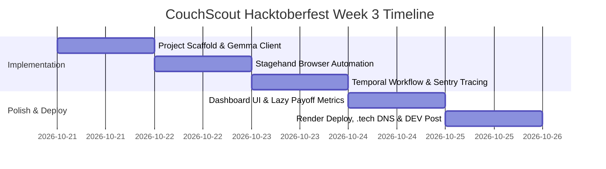

# Implementation Plan: CouchScout (Autonomous Sloth Deal & Bureaucracy Hunter)

**CouchScout** is an autonomous web agent that embodies the Hacktoberfest Week 3 theme **"Slow and Steady" (International Sloth Day)**. It eliminates the tedious cognitive chore of hunting down real deals, price drops, coupons, and product availability across dynamic websites while you relax on the couch. 

Powered by **Gemma** (Google's open-weight model), orchestrated with **Browserbase + Stagehand**, made resilient with **Temporal** durable execution, monitored by **Sentry Agent Tracing**, and deployed on **Render** under a **.tech domain**, CouchScout is architected to stack **6 major Hacktoberfest prize categories** worth up to **$1,050 USD**.

---

## User Review Required

> [!IMPORTANT]
> **API Keys & Credentials Needed for Full Prize Stacking**:
> To qualify for all partner prize categories, you will need free tier or hackathon promo keys from [hacktoberfest.com/my/promos](https://hacktoberfest.com/my/promos):
> 1. **Gemma**: Can run 100% locally via Ollama (`ollama run gemma2:2b` or `9b`) OR via Google AI Studio / Groq / HuggingFace free endpoints.
> 2. **Browserbase / Stagehand**: Browserbase API Key & Project ID (Stagehand also supports local Playwright execution for offline local development).
> 3. **Sentry**: DSN for Sentry Agent Tracing.
> 4. **Temporal**: Local Temporal CLI/Docker or Temporal Cloud free trial.
> 5. **Render & .tech**: Free Render account and coupon code for free 1-year `.tech` domain from the promo portal.

> [!NOTE]
> CouchScout is designed with graceful fallbacks: if an API key (like Browserbase or cloud Temporal) is omitted during local testing, it runs smoothly using local Playwright headless Chromium and in-memory workflow execution.

---

## Open Questions

1. **Primary Runtime Preference**: Would you prefer CouchScout's backend in **TypeScript/Node.js** (native Stagehand + Temporal TS SDK + Sentry) or **Python** (Temporal Python SDK + Playwright/Stagehand Python)?
   *(Recommendation: **TypeScript**, because Browserbase's Stagehand SDK has first-class native TypeScript support with `@browserbasehq/stagehand`)*.
2. **Local Model Setup**: Do you have **Ollama** installed locally to run Gemma (e.g. `gemma2:2b` or `gemma2:9b`), or would you prefer connecting to Gemma via an OpenAI-compatible API endpoint (such as Groq, OpenRouter, or Google AI Studio)?
3. **Demo Scenario**: For the Hacktoberfest video demo and DEV post, our primary showcase deal hunt will be:
   - Scenario A: Multi-retailer price & coupon tracker (e.g., comparing tech gear across Amazon, BestBuy, eBay with discount detection).
   - Scenario B: Warranty / Rebate / Bureaucracy form assistant (filling multi-step web forms from an uploaded receipt).
   *(Recommendation: Scenario A, as it provides instant visual satisfaction and clear "lazy payoff" metrics).*

---

## Target Prize Categories Matrix

| Category | Partner | Prize | Why We Qualify |
| :--- | :--- | :--- | :--- |
| **Top Overall Prize** | DEV / MLH | **$250 USD** + DEV++ | Highly polished project, strong writing, adheres perfectly to the "Slow and Steady" sloth theme. |
| **Best Use of Gemma** | Google | **$200 USD** | Open-weight Gemma powers agent reasoning, DOM understanding, and deal quality synthesis. |
| **Best Use of Render** | Render | **$200 USD** | Full Dockerized deployment configuration (`render.yaml`) hosting backend API and web frontend. |
| **Best Use of Browserbase** | Browserbase | **$100 USD** | Stagehand SDK drives live browser sessions end-to-end (`.observe()`, `.act()`, `.extract()`). |
| **Best Use of Temporal** | Temporal | **$100 USD** | Durable workflows guarantee long-running monitors survive browser timeouts and network hiccups. |
| **Best Use of Sentry Agent Tracing** | Sentry | **$100 USD** | Tracks agent spans, latency, LLM token counts, and browser tool execution. |
| **Best Use of a .tech Domain** | .tech Domains | **$100 USD** | Live production deployment under a `.tech` custom domain (e.g., `couchscout.tech`). |

---

## Architecture & System Design

```
                     ┌────────────────────────────────────────┐
                     │          Web Frontend (UI)             │
                     │  - Deal Task Input & Sloth Dashboard   │
                     │  - Live Browser Stream & Step Timeline │
                     │  - "Lazy Payoff" Metric Counter        │
                     └──────────────────┬─────────────────────┘
                                        │ REST / SSE
                                        ▼
                     ┌────────────────────────────────────────┐
                     │         CouchScout Core Server         │
                     │      (Express / Node.js + Sentry)      │
                     └──────────────────┬─────────────────────┘
                                        │
           ┌────────────────────────────┼────────────────────────────┐
           ▼                            ▼                            ▼
┌────────────────────┐       ┌────────────────────┐       ┌────────────────────┐
│ Temporal Workflow  │       │ Gemma AI Engine    │       │ Stagehand /        │
│ Engine             │◄─────►│ (Open-Weight LLM)  │◄─────►│ Browserbase        │
│ - Durable Search   │       │ - Planning Actions │       │ - .act()           │
│ - Scheduled Drops  │       │ - DOM Reasoning    │       │ - .extract()       │
│ - Automatic Retry  │       │ - Deal Evaluation  │       │ - .observe()       │
└────────────────────┘       └────────────────────┘       └────────────────────┘
           │                            │                            │
           └────────────────────────────┼────────────────────────────┘
                                        ▼
                     ┌────────────────────────────────────────┐
                     │   Sentry OpenTelemetry Agent Tracing   │
                     │    - Token Count, Spans, Tool Calls    │
                     └────────────────────────────────────────┘
```

---

## Proposed Changes & File Structure

We will create a clean, modern TypeScript repository inside `C:\Users\pc\.gemini\antigravity\scratch\couch-scout`:

```
couch-scout/
├── .env.example                     # Sample configuration for API keys & models
├── package.json                     # Dependencies: stagehand, temporalio, @sentry/node, etc.
├── tsconfig.json
├── render.yaml                      # 1-Click Render deployment configuration
├── README.md                        # Documentation with setup, architecture, and video demo
├── docs/
│   └── dev-to-submission-draft.md   # Ready-to-publish DEV.to post with required templates
├── src/
│   ├── config.ts                    # Environment variables & runtime options
│   ├── index.ts                     # Main Express server entrypoint & SSE stream
│   ├── sentry.ts                    # Sentry Agent Tracing initialization
│   ├── ai/
│   │   ├── gemma-client.ts          # Gemma integration (Ollama / OpenAI-compatible endpoint)
│   │   └── prompts.ts               # Sloth-themed system prompts and extractors
│   ├── browser/
│   │   ├── stagehand-manager.ts     # Browserbase & local Stagehand automation driver
│   │   └── actions.ts               # Product search, price extraction, cart & form helpers
│   ├── workflows/
│   │   ├── temporal-client.ts       # Temporal connection setup
│   │   ├── deal-workflows.ts        # Durable workflow definitions (retry, poll, notify)
│   │   └── activities.ts            # Temporal activities running browser automation
│   └── public/                      # Lightweight dashboard frontend
│       ├── index.html               # Sloth UI: input prompt, live progress, deals card
│       ├── style.css                # Clean Tailwind/Modern styling with sloth aesthetics
│       └── app.js                   # Client-side SSE listener & results display
```

---

## Detailed Step-by-Step Implementation

### Phase 1: Environment & Tooling Setup
- Initialize TypeScript project with `@browserbasehq/stagehand`, `@temporalio/workflow`, `@temporalio/activity`, `@sentry/node`, and Express.
- Setup `.env.example` supporting local Ollama (`http://localhost:11434/v1`) or cloud Gemma endpoints, optional Browserbase credentials, and Sentry DSN.

### Phase 2: Open AI Engine (Gemma Integration)
- Implement `gemma-client.ts`: Configures Gemma as the decision-making brain for Stagehand.
- Stagehand natively accepts custom client LLMs (via OpenAI-compatible interfaces). We configure Gemma 2 (2B / 9B) to interpret raw DOM layouts, decide navigation targets, and extract structured product details (title, current price, original price, discount %, return policy, purchase link).

### Phase 3: Browser Automation with Stagehand / Browserbase
- Implement `stagehand-manager.ts`:
  - Initializes Stagehand with session logging.
  - Exposes three core methods:
    1. `searchDeals(query, retailers)`: Navigates retail sites, handles cookie banners/search bars, and gathers listings.
    2. `extractDealSpecs(pageUrl)`: Pulls clean pricing, availability, and seller credibility.
    3. `monitorPrice(pageUrl, targetPrice)`: Checks price against thresholds.

### Phase 4: Durable Workflow Engine with Temporal
- Implement `deal-workflows.ts` & `activities.ts`:
  - Wrap multi-site deal scraping in durable Temporal workflows.
  - Automatically retry when dynamic retail websites experience slow loads or pop-up roadblocks.
  - Implement a `WatchPriceWorkflow` that checks daily/hourly without losing state.

### Phase 5: Sentry Agent Observability
- Configure `sentry.ts` with Sentry Agent Tracing spans:
  - Instrument every agent step: `llm.gemma.reasoning`, `browser.stagehand.act`, `browser.stagehand.extract`, and `workflow.temporal.execution`.
  - Capture real performance metrics (latency, retry count, token consumption) for the DEV.to write-up.

### Phase 6: Sloth Dashboard & "Lazy Payoff" UI
- Build a responsive web interface:
  - Natural language task input: *"Find me the best price on a mechanical keyboard with hot-swappable switches under $70."*
  - Live agent status badge: *"Snoozing while CouchScout works..."*
  - Quantified "Lazy Payoff" scoreboard:
    - **Minutes of manual browsing saved**: e.g., 42 mins.
    - **Dollars saved**: e.g., $34.50.
    - **Tabs not opened**: e.g., 14 tabs avoided.
  - Direct deal cards with confidence ratings and 1-click links.

### Phase 7: Render Deployment & .tech Domain
- Write `render.yaml` for zero-configuration web deployment.
- Configure domain records for the claimed `.tech` domain.

### Phase 8: DEV.to Post & Video Demo Preparation
- Draft `docs/dev-to-submission-draft.md` complying strictly with DEV's Week 3 template:
  - **What I Built**: The Sloth narrative, problem, solution.
  - **Demo**: Deployed `.tech` link + video walkthrough.
  - **Code**: GitHub repo link.
  - **How I Built It**: Gemma open model + Stagehand + Temporal + Sentry.
  - **Why Does Open Innovation Matter?**: Privacy of personal search history, zero per-query vendor taxes, run-anywhere flexibility.
  - **The Lazy Payoff**: Concrete time & money saved metrics.
  - **Prize Categories**: Explicitly tagging Render, Gemma, Browserbase, Temporal, Sentry, and .tech.

---

## 5-Day Execution Timeline (Before Oct 25)



---

## Verification Plan

### Automated Tests
- Unit test for Gemma prompt formatting and structured output parsing (`npm run test:ai`).
- End-to-end integration test for Stagehand headless navigation on mock product pages (`npm run test:browser`).
- Temporal activity failure recovery test (`npm run test:workflow`).

### Manual Verification
1. Run local deal search for a popular product (e.g. "AirPods Pro 2") across 2 different stores.
2. Verify live logs and browser steps in the web UI.
3. Verify Sentry dashboard displays agent trace spans and tool execution timings.
4. Verify Render live deployment and custom `.tech` domain SSL resolution.
